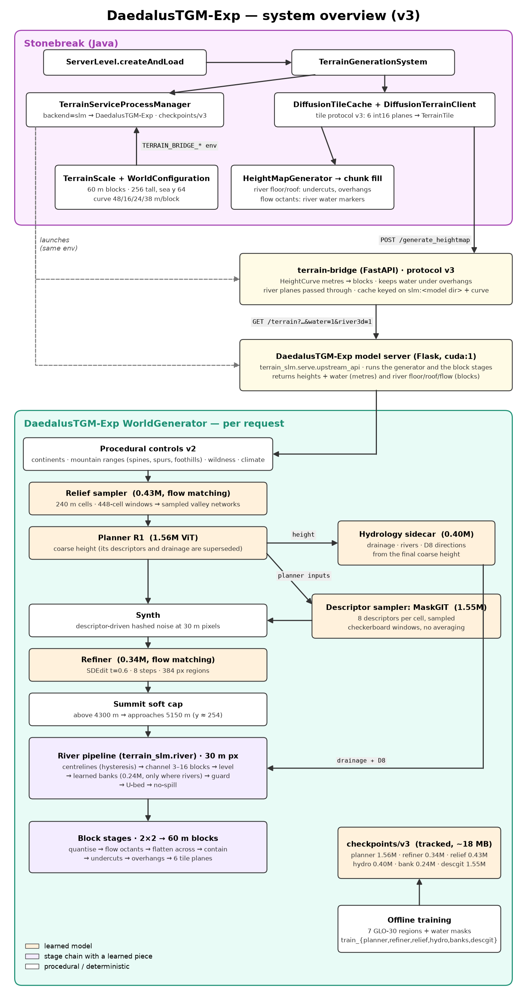

# DaedalusTGM-Exp

**Daedalus Terrain Generation Model (experimental)** is Stonebreak's default terrain generator on
the `Project-Daedalus` branch. It turns procedural control maps into realistic, exaggerated
mountain ranges, valleys and rivers for a 256-block-tall world with 60 m blocks.

- **Architecture, scale, results, limitations:** [`docs/Architecture.md`](docs/Architecture.md)
- **Plan and running log:** [`docs/Terrain-SLM-Plan.md`](docs/Terrain-SLM-Plan.md)
- **System overview:** [`docs/system-overview.png`](docs/system-overview.png)



## Pipeline in one line

Procedural controls (continents, mountain ranges, climate) → **relief sampler** (0.43M, flow
matching; samples valley networks) → **planner** (1.56M ViT; coarse height) → **MaskGIT descriptor
sampler** (1.55M; texture without averaging) and **hydrology sidecar** (0.40M; drainage, rivers,
flow directions) → **synth** → **refiner** (0.34M, flow matching) → summit soft cap → **river
pipeline** (swappable stages: centrelines, 3–16-block channels, **learned banks** (0.24M), bed,
containment, then block stages with **undercuts, overhangs and flow** in the game's 3D tunnel
planes). The game runs it as one child process, `python -m terrain_slm.tgmpipe`, and talks binary
frames over its stdin/stdout (see [`../README.md`](../README.md)).

## Names

| What | Name |
|---|---|
| Model (official) | DaedalusTGM-Exp (`terrain_slm.MODEL_NAME`) |
| Python package / project | `terrain_slm` / `terrain-slm` (uv) |
| Game world generator | `TerrainGeneratorType.DIFFUSION`, served by `TGMPipe` |
| Model id (READY handshake, logs) | `DaedalusTGM-Exp/<checkpoint dir>:p<planner step>:r<refiner step>:l<relief step>` |

## Quickstart

Run everything from this folder (`Models/DaedalusTGM-Exp/`).

```bash
# Environment (Python 3.12, torch cu129 on Linux, cu130 on Windows)
uv sync

# Tests (154; GPU tests pick cuda:1 when two GPUs are present)
.venv/bin/python -m pytest -q
```

### Playing

Nothing to do by hand: just launch the game. On the first launch (and after an update to `uv.lock`
or the GPU kernels) the game sets the model up itself, under the intro and then on a setup screen
that shows each step (Java `ModelSetup` + `ModelSetupScreen`):

1. checks for an NVIDIA GPU (`nvidia-smi`; without one nothing is downloaded and standard terrain still works),
2. finds `uv` (PATH, or a pinned release it downloads into `Models/tools/uv/`),
3. runs `uv sync --frozen` here (Python 3.12, CUDA PyTorch: a few GB the first time),
4. runs `python -m terrain_slm.tgmpipe.warmup`: loads the model on the GPU and compiles the project's
   own kernels (CUDA via NVRTC, C++ via the system compiler) into `Models/kernel_cache/`.

A stamp in `.venv/.stonebreak-setup` records what was set up, so later launches skip all of it and
show nothing. The player can continue to the menu while it runs. Log: `Models/logs/setup.log`.
`-Dstonebreak.modelSetup.force=true` redoes every step; `-Dstonebreak.modelSetup=off` disables it.

Then `TGMPipe` launches `python -m terrain_slm.tgmpipe` with the model in `checkpoints/exp2-r3` (the EXP-2
release; `checkpoints/v4` when a checkout lacks it, or with `-Dstonebreak.tgmpipe.model=checkpoints/v4`) and hands
it the world's scale (`TerrainScale`) in the handshake. The service's log is `Models/logs/tgmpipe.log`.

The service speaks only the terrain protocol on stdio (`terrain_slm/tgmpipe/protocol.py`), so it is not
run by hand. To see it work, run its tests: `tests/test_tgmpipe_process.py` drives the real service
the way the game does, and `tests/test_tgmpipe.py` covers the plumbing without a model. From the game
side, `mvn -pl stonebreak-game test -Dtest=TGMPipeLiveTest -Dstonebreak.tgmpipe.live=true`
(the live test is opt-in: it needs this venv, the model and a CUDA device).

### Data

The data lives in `data/`: either a symlink to a separate data disk, or a plain folder (for example, one extracted from the data package).
There are 7 Copernicus GLO-30 regions: alps, colorado_plateau, sahara_erg, borneo,
great_plains, norway and east_africa.

```bash
.venv/bin/python scripts/download_region.py --region alps
.venv/bin/python -m terrain_slm.data.build --region alps
.venv/bin/python -m terrain_slm.data.water --region alps     # water masks for the bank model
```

Building a region's drainage uses `terrain_slm/data/hydrology/` (depression fill, D8 flow). WorldClim is read from `Dev Working/terrain-diffusion-spike/`.

### Training

Training on another machine (for example a single 5090): see [`docs/Remote-Training.md`](docs/Remote-Training.md).

Run one training job per GPU. Two jobs on one card run about 15× slower.

```bash
.venv/bin/python -m terrain_slm.train.train_relief  --out checkpoints/relief_r0  --device cuda:1   # ~11 min
.venv/bin/python -m terrain_slm.train.train_planner --out checkpoints/planner_r1 --dim 176 --depth 4 --steps 40000
.venv/bin/python -m terrain_slm.train.train_refiner --out checkpoints/refiner_r0 --steps 30000
.venv/bin/python -m terrain_slm.train.train_hydro   --out checkpoints/hydro_h0     # ~8 min
.venv/bin/python -m terrain_slm.train.train_banks   --out checkpoints/bank_b0      # ~6 min, needs water.npz
.venv/bin/python -m terrain_slm.train.train_descgit --out checkpoints/descgit_d0   # ~20 min
```

Optional models load when their file is in the model dir (`relief.pt`, `hydro.pt`, `bank.pt`,
`descgit.pt`, and in v4 `detail.pt` + `biome.pt`); without one, that stage falls back to the previous behaviour.
v4 (`checkpoints/v4`, the default 2026-09-28 to 2026-11-19) needs no `descgit.pt`; see `docs/Architecture.md` §1a/§1b.
EXP-2 folders (with `climate.pt`) load through `world/generator2.py`; the default is `checkpoints/exp2-r3`.

### Shipping a model

1. Assemble a model folder of symlinks to the runs' checkpoints (`planner.pt`, `relief.pt`, `detail.pt`, ...;
   e.g. `checkpoints/exp2/world_exp2b`), and record every run in `scripts/release_provenance.json` (data,
   init chain, evidence). Then build the release, a **new** directory of real, inference-only files:
   `.venv/bin/python scripts/make_release.py checkpoints/exp2/world_exp2b checkpoints/exp2-r2 --device cuda:1`.
   It refuses a run trained (or initialised from one trained) on WorldClim / FABDEM / EEA-10 / unconfirmed
   CHELSA-TraCE21k data, writes `release.json` (sha256, sizes, sources, licences, `content_id`), copies
   `ATTRIBUTION.md`, and proves tiles from the release are bit-identical to the source folder (1:4 and 1:2).
2. Point the game at the new directory: `TGMPipe.DEFAULT_MODEL`, or
   `-Dstonebreak.tgmpipe.model=`. Update `ATTRIBUTION.md` if the sources changed.
3. Un-ignore the new directory in `.gitignore`: copy the two `!/checkpoints/v3...` lines. v3 was about 9 MB in
   plain git; v4 is ~131 MB with a 99 MB `detail.pt` (bf16) — GitHub's hard limit is 100 MiB per file, so
   consider Git LFS. Store big models' weights as bf16 (lossless for the bf16-autocast samplers).
4. Re-scan a new detail checkpoint for in-game stability before shipping it (`[detail] WARNING` lines; see
   Architecture §1a) — validation alone does not catch it.

The service's disk cache needs no care: its namespace hashes the world config, every checkpoint's
training step and the generator's source (everything under `terrain_slm/` except `train/`, `eval/`,
`export/` and `tgmpipe/`), so a retrained model or an edited pipeline starts a fresh namespace on its
own. Old namespaces age out under the one byte budget (`--disk-cache`, 8 GB).

### Evaluating

```bash
.venv/bin/python -m terrain_slm.eval.mountains --seed 2 --out reports/v3   # block stats vs real Alps + hillshade
.venv/bin/python -m terrain_slm.eval.sheet --model checkpoints/v3          # held-out eval sheet
```

## Layout

```
terrain_slm/        package: data/ synth/ models/ river/ train/ world/ tgmpipe/ eval/ · paths.py · device.py · biomes.py
tests/              pytest suite
scripts/            download_*.py · make_release.py + release_provenance.json
configs/
docs/               Architecture.md · Terrain-SLM-Plan.md · system-overview.{png,py} · diagnostics/
checkpoints/        exp2-r3/ = the shipping EXP-2 release (ignored for now: 590 MB + native/ export 144 MB; exp2-r1 kept for worlds created on it); v4/ v3/ v2/ = EXP-1 (tracked, WorldClim-trained); training runs are ignored
reports/            evaluation output (ignored)
data/               training data: a folder, or a symlink to a data disk (ignored)
```
